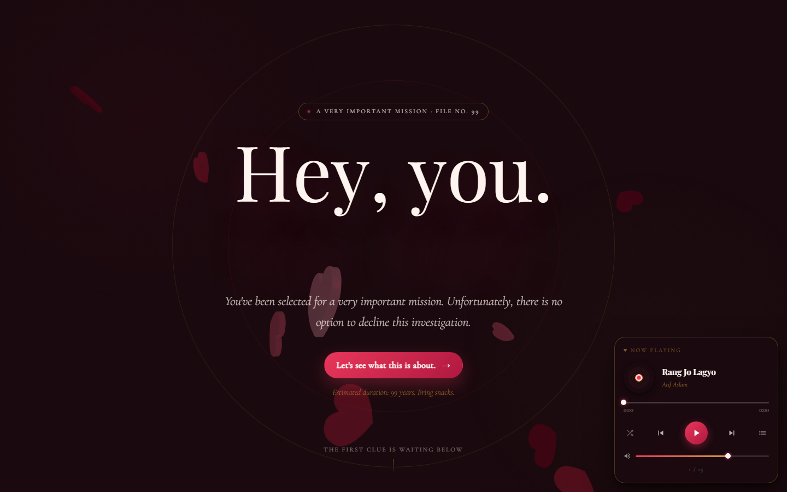
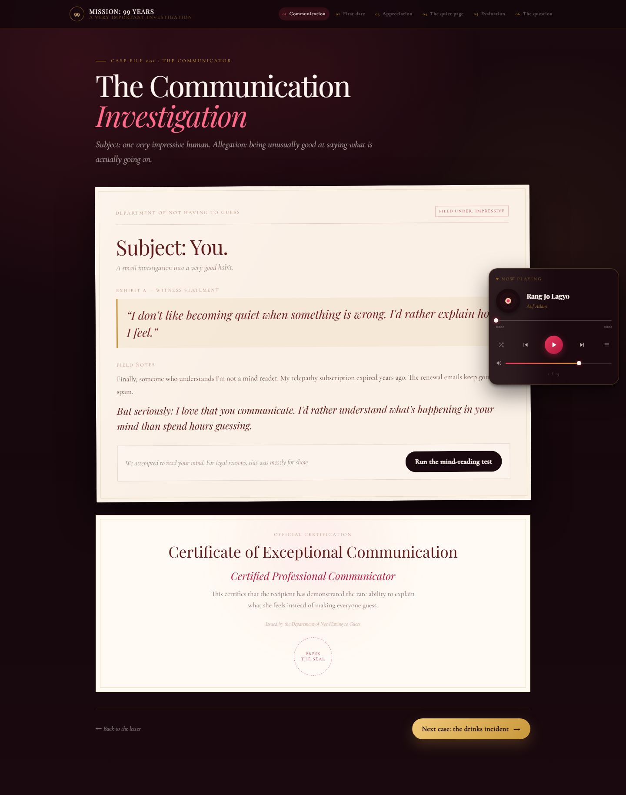
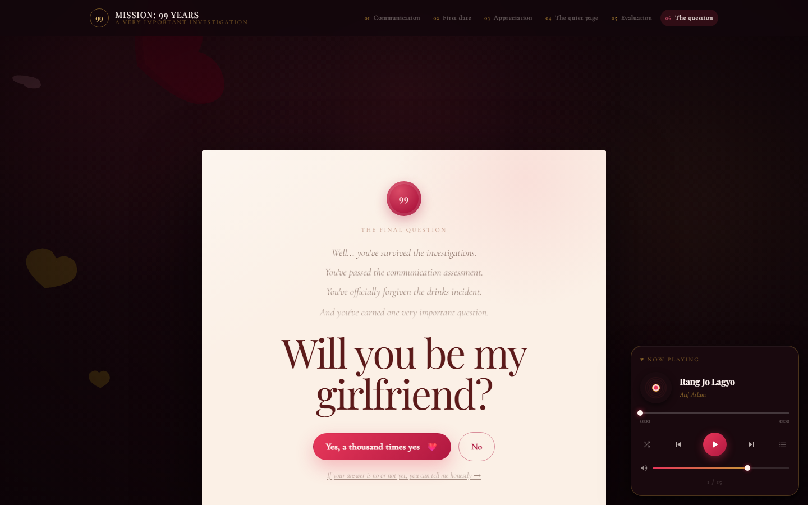
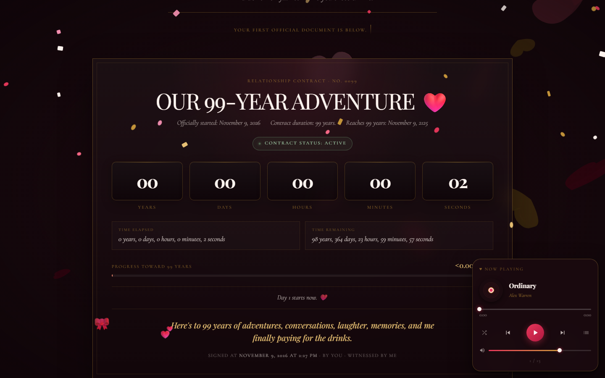
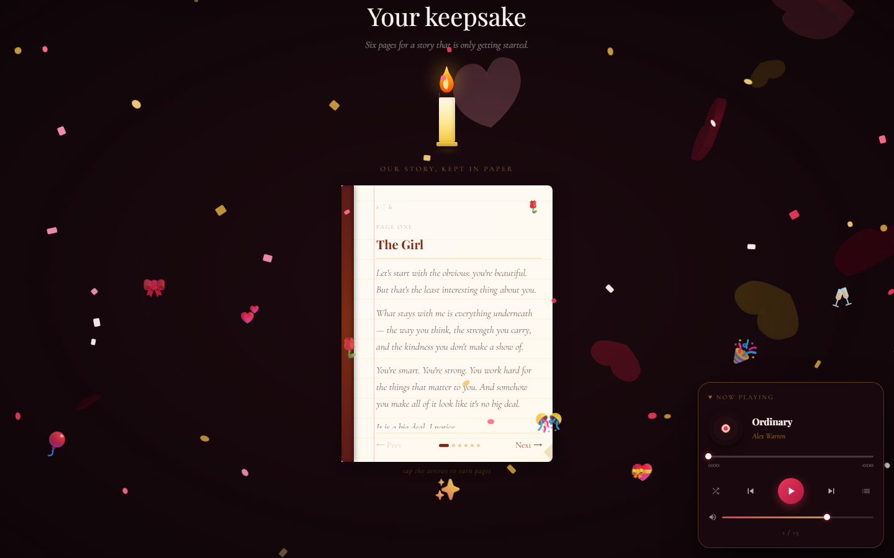
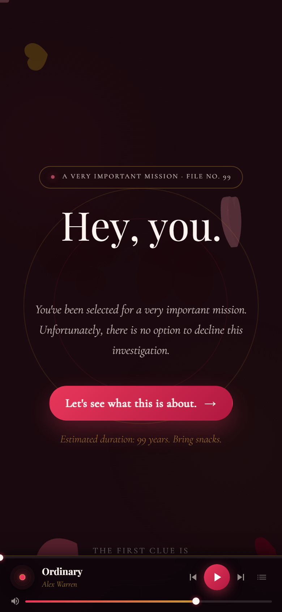
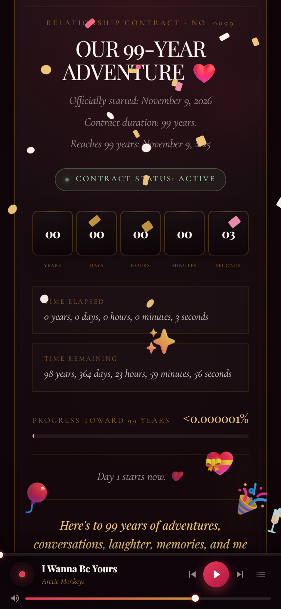
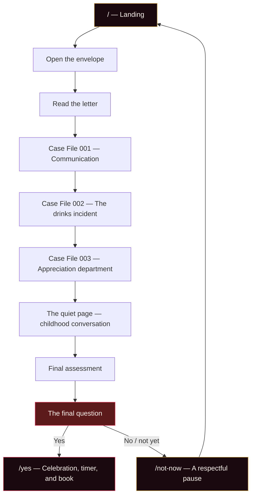

<div align="center">

# Mission: 99 Years

**A personalized, interactive proposal experience — built with React, TypeScript, and a suspicious amount of paperwork.**

Six case files, one very important question, and a 99-year contract that only starts when the answer is _yes_.

<br />


</div>

---

## Overview

This is a personalized build of the original **Will You Be My Girlfriend** project. Instead of a single question, it turns the proposal into a lighthearted investigation:

- the recipient's communication style,
- the first-date drinks incident,
- six qualities worth appreciating,
- a childhood conversation that meant something,
- a final assessment,
- and then the actual question.

The tone is funny, but the choice is treated seriously. The playful _No_ button eventually stops running away, and a clearly visible, honest "not yet" path is always available. Saying _yes_ starts a persistent 99-year timer and unlocks a six-page keepsake book.

> **This repository is a personal, local build.** It is not deployed from this folder, and no publishing or pushing is performed here. The upstream demo link has intentionally been left out.

---

## Screenshots

<div align="center">

  
  <br />
  <i>The landing page and the very important mission</i>
  <br /><br />

  
  
  <br />
  <i>One of six case files and the final question</i>
  <br /><br />

  
  
  <br />
  <i>The 99-year contract and the keepsake book</i>
  <br /><br />

  
  
  <br />
  <i>Responsive layouts tested down to 320px</i>

</div>

---

## The Journey



| Route           | Stage                                                                 |
| --------------- | --------------------------------------------------------------------- |
| `/`             | Landing hero, envelope, and personal letter                           |
| `/communication`| Communication investigation, mind-reading test, and certificate       |
| `/first-date`   | The drinks incident report and official apology                       |
| `/appreciation` | Six expandable quality files and a department verdict                 |
| `/childhood`    | A quiet page about being listened to                                  |
| `/evaluation`   | Animated final assessment                                             |
| `/proposal`     | The final question, playful _No_, and honest "not yet" option         |
| `/yes`          | Celebration, 99-year contract timer, and six-page book                |
| `/not-now`      | Respectful decline page; the timer stays paused                       |

Unknown routes redirect to `/`.

---

## Features

| Feature | Description |
| --- | --- |
| **Personalized story** | All copy is driven by the supplied memories and qualities — communication, the first-date drinks moment, listening, and the six appreciation files. |
| **3D heart scene** | The original Three.js floating-heart background is preserved on the landing, proposal, and celebration pages. |
| **Animated hero** | Letter-by-letter Anime.js title reveal with the original serif typography. |
| **Interactive envelope** | Keyboard-accessible SVG envelope, animated flap, personal letter, and a separate playful _No_ that only applies to opening the case file. |
| **Runaway _No_ (proposal)** | The first three _No_ clicks dodge playfully. After that, the button becomes stationary, and the page clearly states that the answer will be respected. |
| **Honest decline path** | A visible "If your answer is no or not yet..." link and the respectful `/not-now` page are always reachable. No dark patterns, no forced yes. |
| **Certificate interactions** | Communication test, official seal, stamps, review counters, and animated evaluation results. |
| **Yes celebration** | Confetti, balloons, personalized celebration copy, and a smooth entrance animation. |
| **99-year timer** | Starts at the exact YES click, persists across reloads, shows elapsed/remaining time, progress, contract status, and rotating contract notices. |
| **Six-page keepsake** | A personalized flip book with keyboard support, page navigation, candles, and a 3D cover. |
| **Persistent music** | The original YouTube-powered player stays mounted across routes, with shuffle, playlist, seek, and mobile controls. |
| **Responsive and accessible** | Skip link, `main#main` landmarks, keyboard controls, visible focus states, reduced-motion support, and layouts tested from 320px to desktop. |

---

## Timer behavior

The timer is deliberately strict about when it starts:

1. Nothing is stored before the recipient clicks **Yes, a thousand times yes**.
2. On that click, `acceptProposal()` writes the exact ISO timestamp to `localStorage` under `wymg.relationship.acceptedAt.v1`.
3. Reloading, revisiting, or clicking YES again never changes the original timestamp.
4. Visiting `/yes` without a valid timestamp redirects to `/proposal`.
5. The contract ends after **99 calendar years**, not 99 × 365 days.
6. Leap-day starts are clamped correctly: **February 29, 2024 → February 28, 2123**.
7. The display includes elapsed years/days/hours/minutes/seconds, remaining time, progress, `ACTIVE`/`COMPLETE` status, and funny contract notices.
8. Choosing "not yet" leaves the timer unstarted. The `/not-now` page explains that the timer stays paused.

The timer recalculates every second and resynchronizes when the tab becomes visible again.

To reset the timer during local testing, run this in the browser console:

```js
localStorage.removeItem("wymg.relationship.acceptedAt.v1");
```

---

## Tech stack

| Layer | Technology |
| --- | --- |
| Framework | React 19 + TypeScript 6 |
| Build tool | Vite 8 |
| Routing | React Router DOM 7 |
| 3D graphics | Three.js |
| Animation | Anime.js 4 |
| Styling | Tailwind CSS 4 + CSS custom properties in `src/styles/experience.css` |
| Music | YouTube IFrame Player API |
| Deployment | Vercel SPA rewrites configured in `vercel.json` |

**Tooling note:** TypeScript is pinned to `~6.0.3` because `typescript-eslint` 8.x cannot run with TypeScript 7.0. This keeps `npm run lint` and the production build working with the current toolchain.

---

## Project structure

```text
will-you-be-my-girlfriend-personal/
├── docs/
│   └── screenshots/              # Desktop and mobile verification screenshots
├── public/
├── src/
│   ├── App.tsx                   # Router, skip link, persistent MusicPlayer
│   ├── main.tsx                  # React entry point and stylesheet imports
│   ├── index.css                 # Base theme and global styles
│   ├── styles/
│   │   └── experience.css        # Journey, case-file, timer, and book styling
│   ├── components/
│   │   ├── Celebration.tsx       # Confetti and balloons
│   │   ├── Envelope.tsx          # Letter dialog and playful envelope No
│   │   ├── HeartScene.tsx        # Three.js floating hearts
│   │   ├── HeroSection.tsx       # Animated landing hero
│   │   ├── JourneyLayout.tsx     # Sticky progress header and shared journey shell
│   │   ├── LoveBook.tsx          # Six-page keepsake book
│   │   ├── MusicPlayer.tsx       # Persistent YouTube player
│   │   └── StageFooter.tsx       # Back/next navigation between stages
│   ├── data/
│   │   ├── personalization.ts    # ALL personalized copy and book pages
│   │   └── songs.ts              # Featured and playlist songs
│   ├── lib/
│   │   └── relationship.ts       # Acceptance timestamp, 99-year math, formatting
│   └── pages/
│       ├── HomePage.tsx
│       ├── CommunicationPage.tsx
│       ├── FirstDatePage.tsx
│       ├── AppreciationPage.tsx
│       ├── ChildhoodPage.tsx
│       ├── EvaluationPage.tsx
│       ├── ProposalPage.tsx
│       ├── YesPage.tsx
│       ├── NotNowPage.tsx
│       └── LoveTimer.tsx
├── index.html
├── vercel.json
├── vite.config.ts
└── package.json
```

---

## Getting started

### Prerequisites

- **Node.js** 20+ (20.19+ recommended for Vite 8)
- **npm**

### Install and run

```bash
cd will-you-be-my-girlfriend-personal
npm install
npm run dev
```

Open the URL printed by Vite (typically `http://localhost:5173`).

### Production build

```bash
npm run build
npm run preview
```

### Lint

```bash
npm run lint
```

The production build may report a chunk-size advisory because the preserved Three.js scene is larger than Vite's default warning threshold. It is a warning, not a build failure.

---

## Customization guide

### 1. All personalized text

Edit `src/data/personalization.ts`. It contains every piece of copy used by the experience:

- `mission` — landing hero
- `letter` — envelope letter and envelope _No_ messages
- `communication` — communication case file and certificate
- `firstDate` — drinks incident, receipt, and apology
- `qualities` — the six appreciation files
- `appreciation` — department intro and verdict
- `childhood` — the quiet page
- `evaluation` — loading lines and final assessment results
- `proposal` — final question, runaway _No_ messages, respectful note, and labels
- `celebration` — YES page copy
- `contract` — timer headings, status, notices, and contract lines
- `notNow` — respectful decline page
- `bookPages` — all six keepsake book pages
- `journeyStages` — progress labels and stage order

Keeping the copy here means you can personalize the story without touching component logic.

### 2. Timer key and duration

`src/lib/relationship.ts` contains:

```ts
export const RELATIONSHIP_STORAGE_KEY = "wymg.relationship.acceptedAt.v1";
export const CONTRACT_YEARS = 99;
```

Change these only if you intentionally want a different storage key or contract length. The calendar-year math and leap-day handling are in the same file.

### 3. Music

Edit `src/data/songs.ts`:

```ts
export const FEATURED_SONGS = [
  /* opener pool — one is picked at random */
];

export const PLAYLIST_SONGS = [
  /* rest of the queue */
];
```

Each song needs a YouTube `id`, `title`, and `artist`. The player picks one featured song at random on load, then adds the remaining featured songs to the queue.

If you switch music providers, update the `frame-src` and `script-src` rules in `vercel.json` to allow the new domain. Otherwise the browser's Content Security Policy will block it.

### 4. Styling and theme

Journey-specific styles live in `src/styles/experience.css`. The main color tokens are at the top of that file:

```css
:root {
  --rose: #e8375a;
  --rose-light: #ff6b8a;
  --rose-deep: #b01840;
  --cream: #fff5f0;
  --gold: #c8973a;
  --ink: #1a0a0f;
}
```

The original base theme remains in `src/index.css`.

### 5. Proposal behavior

The final question and _No_ flow are in `src/pages/ProposalPage.tsx`, with its copy in `proposal` inside `personalization.ts`. The number of playful dodges is controlled by `proposal.noMessages.length`.

The honest decline route is `/not-now`, rendered by `src/pages/NotNowPage.tsx`.

---

## Verification performed

The experience was checked with a temporary Playwright harness (not added as a project dependency) and manual breakpoint audits:

- Full desktop flow from landing to YES, contract, and book page turn.
- Full mobile flow at 390 × 844.
- Interaction checks at 320 × 568, including keyboard opening of the envelope and book.
- Layout audits at 1440 × 900, 390 × 844, 320 × 568, 360 × 740, 768 × 1024, and 844 × 390.
- No horizontal overflow, text clipping, or header overlap found.
- YES timestamp persisted after reload and stayed unchanged after a second YES click.
- `/yes` redirected to `/proposal` without a valid acceptance timestamp.
- Leap-year check: February 29, 2024 → February 28, 2123.
- No page errors or application console errors. Only external or pre-existing warnings appeared: Three.js `Clock` deprecation, WebGL/GPU driver messages, and the YouTube `web-share` feature warning.
- `npm run lint` passes.
- `npm run build` passes; only the preserved Three.js chunk-size advisory remains.

Screenshots from these checks are in `docs/screenshots/`.

---

## Deployment

Deployment is optional and is **not** performed by this project.

The included `vercel.json` provides SPA rewrites so client-side routes such as `/yes`, `/proposal`, and `/not-now` resolve correctly. If you choose to deploy:

1. Use **Build command:** `npm run build`
2. Use **Output directory:** `dist`
3. Make sure all routes fall back to `index.html` on non-Vercel hosts.

The CSP in `vercel.json` currently allows the YouTube player. Update it if you change music providers.

---

## Browser support

Works best in modern browsers with WebGL support: Chrome, Edge, Firefox, and Safari. Mobile layouts include a bottom-bar music player with safe-area padding for notched devices.

Music requires a user gesture because of browser autoplay rules. The app handles this with a full-screen **Tap to play music** overlay on first load.

Reduced-motion preferences are respected by the experience styles.

---

## Attribution

Personalized build based on the original **Will You Be My Girlfriend** project by [WIZARDOF-OZ](https://github.com/WIZARDOF-OZ/Will_You_Be_My_Girlfriend). The original repository is not modified or published by this build.

---

<div align="center">

Made with 💖 · _For my favourite person_

</div>
